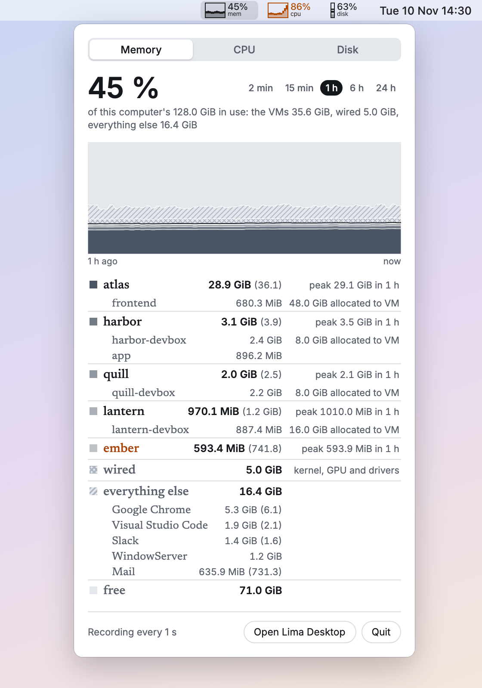
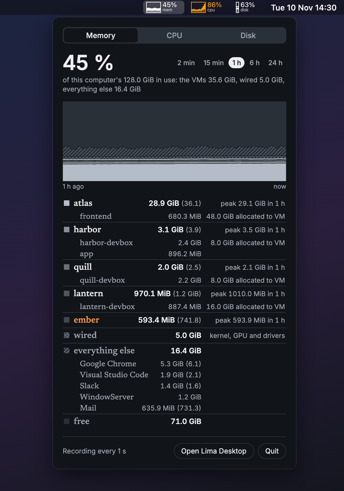
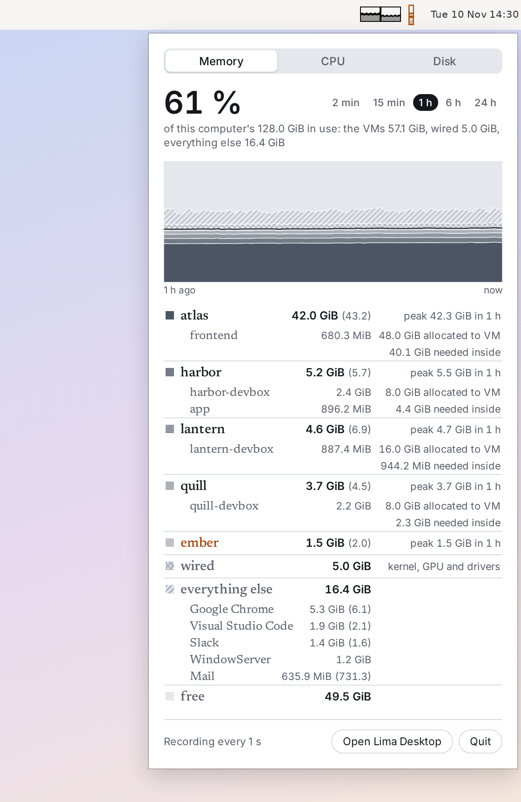
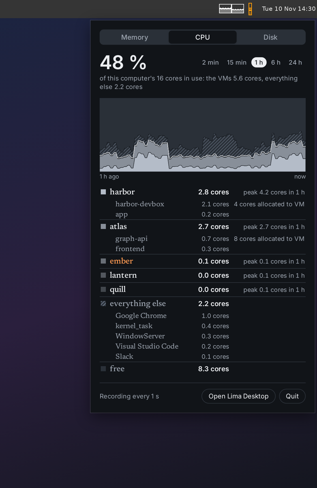

# Lima Desktop

A small desktop app for [Lima](https://lima-vm.io) VMs and the podman containers in them: every instance at once, with a long history of CPU, memory, pressure and disk — for the VM and for each container — so you can see OOMs coming and right-size VMs.

**Status:** early. macOS first (Linux builds too). Podman 5 or newer only (an older one is named, not half-read); compose projects shown read-only.

<p>
  
  
</p>

- Every Lima instance, live: status, allocation vs use, memory/CPU pressure (PSI), OOM kills, and what each VM costs your computer (hypervisor RAM/CPU, the disk image's real size).
- Start, stop, restart, delete; resize CPUs/memory/disk of a stopped VM, with right-sizing hints from the history (peaks, p95, pressure, OOM kills).
- Containers per VM, grouped by compose project, with live CPU/memory/peak/net; start, stop, restart, remove, logs, inspect; `podman system df`.
- History at 1 Hz kept 7 days, per-minute rollups a year, in SQLite (~0.7 GB/week for 10 VMs and 100 containers — [measured](./docs/design/metrics-storage.md)).
- The whole computer's memory, CPU and disk in the menu bar, the VMs' part drawn in, in orange past a threshold you choose; click one for what's using it: each VM and its containers, and the busiest apps outside them.
- Instances owned by another tool (e.g. foldyard) can say so with a [managed-by marker](./docs/design/managed-by.md); the app leaves the operations they keep alone.

Nothing is installed in the guests: the app reads them over Lima's own ssh and talks to podman over the socket Lima already forwards.

**A VM's page**: what it needs, and why.

<picture>
  <source media="(prefers-color-scheme: dark)" srcset="https://daaain.github.io/lima-desktop/vm-dark.png">
  
</picture>

**Containers**, across every running VM.

<picture>
  <source media="(prefers-color-scheme: dark)" srcset="https://daaain.github.io/lima-desktop/containers-dark.png">
  
</picture>

**Images**, and what removing the unused ones would free.

<picture>
  <source media="(prefers-color-scheme: dark)" srcset="https://daaain.github.io/lima-desktop/images-dark.png">
  
</picture>

**Volumes**, with their sizes and who uses them.

<picture>
  <source media="(prefers-color-scheme: dark)" srcset="https://daaain.github.io/lima-desktop/volumes-dark.png">
  
</picture>

**The menu bar**: memory, CPU and disk at a glance, and the popover under each.

<p>
  
  
</p>

**On Linux**, the items sit in the panel's tray, and their menu opens the popover. GNOME shows them only with the [AppIndicator extension](https://extensions.gnome.org/extension/615/appindicator-support/), which Ubuntu has switched on. A panel shows each item's drawing alone, and the popover has the figures.

<p>
  
  
</p>

Orange is a warning. The disk item is orange because the disk has less space free than the warning set in Settings. `ember` is orange because the VM has stopped answering, most likely because it's out of memory, so its figures are the last it reported.

The screenshots are of invented VMs and containers, and there are [more of them here](https://daaain.github.io/lima-desktop/).

## Install

Download it from [Releases](https://github.com/daaain/lima-desktop/releases): a universal `.dmg` for macOS (Apple silicon and Intel), and a `.deb` or an AppImage for Linux (x86_64). It needs Lima 2 (`limactl`).

The macOS build isn't signed with an Apple Developer ID yet. macOS quarantines anything downloaded, so it refuses to open the app and says it "is damaged" or "can't be checked". After dragging the app to Applications, remove the quarantine once:

```bash
xattr -dr com.apple.quarantine "/Applications/Lima Desktop.app"
```

## Develop

To build it yourself, or to work on it, see [DEVELOPMENT.md](./DEVELOPMENT.md).
